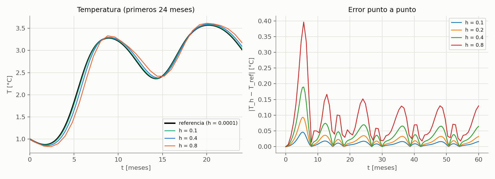
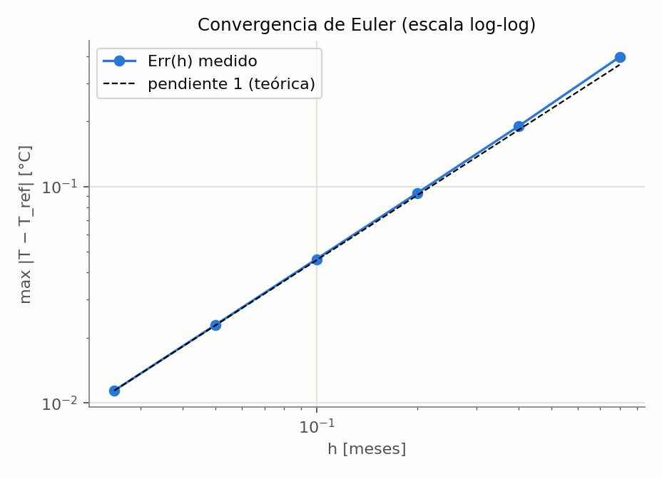
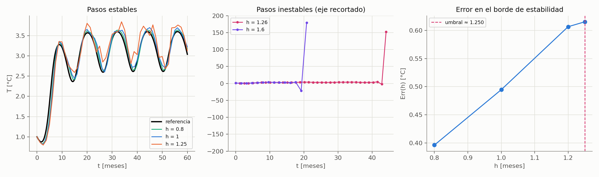
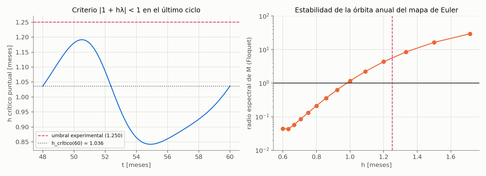
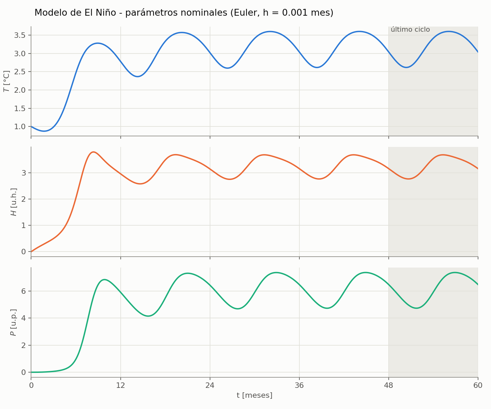
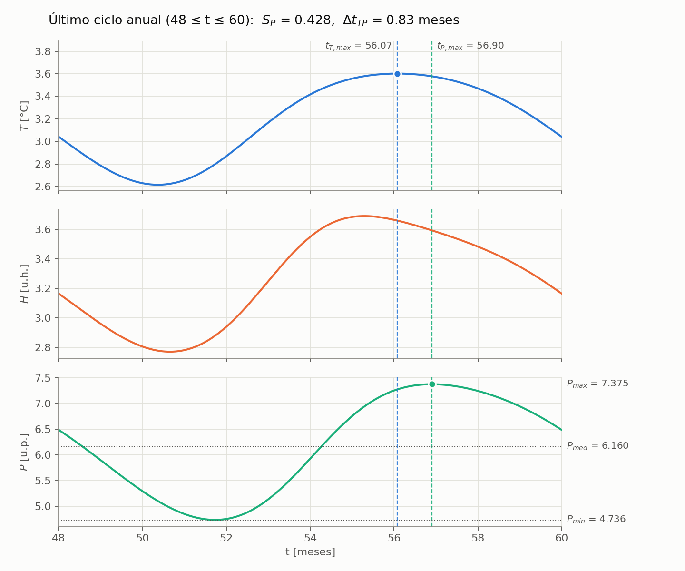
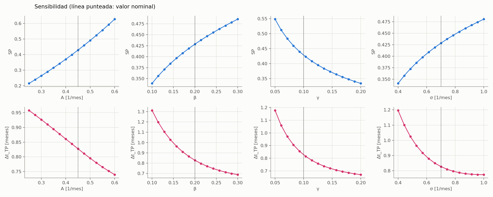
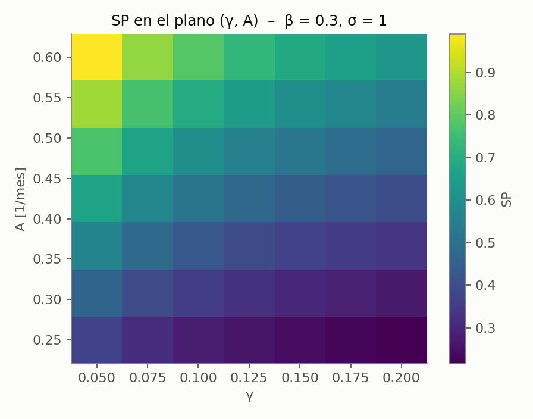
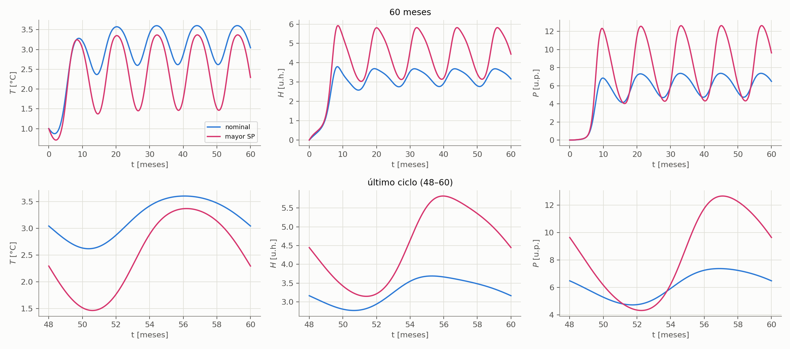
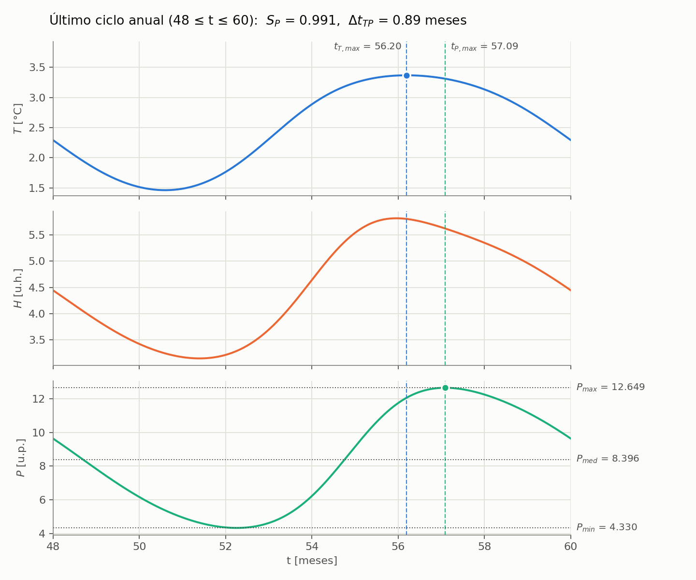

# TRABAJO PRÁCTICO "EL SUPER NIÑO"

**UNIVERSIDAD DE BUENOS AIRES**
**FACULTAD DE INGENIERÍA – DPTO. DE COMPUTACIÓN**

| | |
|---|---|
| **T.P. N°** | 1 |
| **Asignatura** | Modelación numérica (CB-051) / Análisis Numérico I (9504) |
| **Cuatrimestre** | 2do. Cuatrimestre 2026 |
| **Grupo de trabajo práctico** | N° 1 |
| **Fecha de realización** | 1/11/2026 |
| **Fecha de entrega** | 13/11/2026 |

**Integrantes del trabajo práctico**

| Nombre y apellido | Padrón |
|---|---|
| Ezequiel Ariel Miño | 107646 |
| Agustín Lucchelli | 109337 |
| Lorenzo Busato | 110490 |

---

## Índice

1. [Introducción al trabajo práctico](#1-introducción-al-trabajo-práctico)
2. [Parte 1: Convergencia, orden y estabilidad del método de Euler explícito](#2-parte-1-convergencia-orden-y-estabilidad-del-método-de-euler-explícito)
   - 2.1. Solución de referencia
   - 2.2. Resolución con sucesivos pasos h
   - 2.3. Verificación experimental
   - 2.4. Resolución con el paso temporal aumentado
3. [Parte 2: Severidad estacional, desfase y sensibilidad paramétrica](#3-parte-2-severidad-estacional-desfase-y-sensibilidad-paramétrica)
   - 3.1. Determinación de parámetros nominales
   - 3.2. Análisis e influencia de los factores
   - 3.3. Combinaciones posibles de los factores
   - 3.4. Comparación de casos
4. [Código de Python](#4-código-de-python)
5. [Bibliografía y fuentes](#5-bibliografía-y-fuentes)

---

## 1. Introducción al trabajo práctico

El fenómeno El Niño – Oscilación del Sur es un ejemplo de sistema dinámico acoplado: una perturbación térmica del océano puede producir, con cierto retardo, respuestas en la humedad atmosférica y en la precipitación. En este trabajo se utiliza un modelo temporal simplificado de tres variables para estudiar, por un lado, propiedades numéricas del método de Euler explícito aplicado a un problema de valores iniciales (convergencia, orden y estabilidad) y, por otro, la respuesta del modelo frente a cambios en sus parámetros.

Las variables del modelo son $T(t)$, la anomalía de temperatura superficial del mar [°C]; $H(t)$, la anomalía de humedad en la atmósfera baja [u.h.]; y $P(t)$, una variable simplificada asociada a la precipitación o nubosidad [u.p.]. Se resuelve el sistema de ecuaciones diferenciales ordinarias no lineales

$$\frac{dT}{dt} = R(t)\,T\left(1-\frac{T}{T_{max}}\right) - \alpha H$$

$$\frac{dH}{dt} = \beta T^2 - \gamma H P$$

$$\frac{dP}{dt} = \delta H^2 - \sigma P$$

con una excitación estacional de período anual en la tasa de crecimiento térmico:

$$R(t) = R_{oce} + A\cos(\omega t - \pi), \qquad \omega = \frac{2\pi}{12}$$

Cada término tiene un papel físico: $R(t)T(1-T/T_{max})$ es un crecimiento logístico de la temperatura modulado por las estaciones; $-\alpha H$ es el enfriamiento por evaporación; $\beta T^2$ es la fuente de humedad (un mar más caliente evapora más); $-\gamma HP$ es el consumo de humedad por la lluvia; $\delta H^2$ es la conversión de humedad en lluvia y $-\sigma P$ es la descarga o disipación de la precipitación sobre el continente.

**Parámetros nominales**

| Parámetro | Significado físico | Valor nominal |
|---|---|---|
| $T_{max}$ | Anomalía máxima térmicamente sostenible | 4,0 °C |
| $R_{oce}$ | Tasa intrínseca de calentamiento oceánico | 0,30 mes⁻¹ |
| $\alpha$ | Coeficiente de enfriamiento por evaporación | 0,05 |
| $\beta$ | Eficiencia de evaporación | 0,20 |
| $\gamma$ | Tasa de consumo de humedad por precipitación | 0,10 |
| $\delta$ | Eficiencia de conversión de humedad a lluvia | 0,40 |
| $\sigma$ | Tasa de descarga/disipación sobre el continente | 0,70 mes⁻¹ |
| $A$ | Amplitud de la modulación estacional | 0,45 mes⁻¹ |
| $\omega$ | Frecuencia angular de un ciclo anual | $2\pi/12$ rad/mes |

Condiciones iniciales: $T(0)=1{,}0$ °C, $H(0)=0$ u.h., $P(0)=0$ u.p. Intervalo de integración: $0 \le t \le 60$ meses.

El trabajo se divide en dos partes. En la Parte 1 se analiza el comportamiento numérico del método de Euler explícito. En la Parte 2 se usa una discretización suficientemente precisa y estable para estudiar la severidad estacional de las precipitaciones, el desfase entre temperatura y precipitación y la sensibilidad a los parámetros $A$, $\beta$, $\gamma$ y $\sigma$. Todo el código está en Python (sección 4): cada script reproduce, en el mismo orden, lo que se presenta en este informe.

---

## 2. Parte 1: Convergencia, orden y estabilidad del método de Euler explícito

### 2.1. Solución de referencia

Se resuelve el sistema con el método de Euler explícito,

$$y_{n+1} = y_n + h\,f(t_n, y_n), \qquad y = [T, H, P]^T$$

que, escrito por componentes, es

$$T_{n+1} = T_n + h\left[R(t_n)\,T_n\left(1-\frac{T_n}{T_{max}}\right) - \alpha H_n\right]$$

$$H_{n+1} = H_n + h\left[\beta T_n^2 - \gamma H_n P_n\right]$$

$$P_{n+1} = P_n + h\left[\delta H_n^2 - \sigma P_n\right]$$

con $R(t_n) = R_{oce} + A\cos(\omega t_n - \pi)$.

La consigna pide una solución de referencia, también obtenida con Euler, pero con un paso $h_{ref}$ tan pequeño que su error sea despreciable frente al de las discretizaciones que se analizan. Se adoptó

$$h_{ref} = 0{,}0001\ \text{meses}$$

lo que equivale a 600.000 pasos. Para verificar que este paso alcanza, se repitió el cálculo con $h_{ref}/2$ y se comparó: la diferencia máxima en $T$ es de 2,28e-05 °C. Como el menor error que se mide más adelante es 0,0114 °C, el error de la referencia es del orden del 0,2 % del menor error analizado, por lo que es despreciable.


### 2.2. Resolución con sucesivos pasos h

Se resolvió nuevamente el problema con los pasos $h = 0{,}025;\ 0{,}05;\ 0{,}1;\ 0{,}2;\ 0{,}4;\ 0{,}8$ meses, donde cada valor es el doble del anterior. Todos son múltiplos de $h_{ref}$, de modo que las soluciones se comparan en los mismos instantes. El error se cuantifica con el máximo error absoluto de $T$ sobre todo el intervalo:

$$Err(h) = \max_{0 \le t \le 60} \left| T_h(t) - T_{ref}(t) \right|$$

**Tabla 1.** Error máximo en T respecto de la referencia.

| h [meses] | Pasos | Err(h) [°C] | Instante del error máximo [meses] |
|---|---|---|---|
| 0,025 | 2400 | 0,011393 | 5,2 |
| 0,050 | 1200 | 0,022904 | 5,2 |
| 0,100 | 600 | 0,046135 | 5,3 |
| 0,200 | 300 | 0,093319 | 5,4 |
| 0,400 | 150 | 0,189660 | 5,6 |
| 0,800 | 75 | 0,396165 | 5,6 |



*Figura 1: Temperatura para distintos pasos frente a la referencia (izquierda) y error punto a punto (derecha).*

El error crece al aumentar el paso y lo hace de forma aproximadamente proporcional a $h$: cuando $h$ se duplica, el error se duplica aproximadamente. El máximo error se produce siempre alrededor de $t \approx$ 5,2–5,6 meses, que es donde $T$ crece más rápido (interpretación: Euler utiliza la pendiente al inicio de cada paso y se retrasa donde la pendiente cambia más).


### 2.3. Verificación experimental

En el rango convergente se calcula el orden observado entre cada par de pasos consecutivos:

$$p = \frac{\log\left(Err(2h)/Err(h)\right)}{\log 2}$$

**Tabla 2.** Orden observado de convergencia.

| h → 2h | Err(h) [°C] | Err(2h) [°C] | p |
|---|---|---|---|
| 0,025 → 0,050 | 0,011393 | 0,022904 | 1,0075 |
| 0,050 → 0,100 | 0,022904 | 0,046135 | 1,0103 |
| 0,100 → 0,200 | 0,046135 | 0,093319 | 1,0163 |
| 0,200 → 0,400 | 0,093319 | 0,189660 | 1,0232 |
| 0,400 → 0,800 | 0,189660 | 0,396165 | 1,0627 |

El orden observado es $p \approx$ 1,024 en promedio (entre 1,007 y 1,063), prácticamente igual al valor teórico $p = 1$ del método de Euler explícito (error global $O(h)$). El orden tiende a 1 a medida que $h$ disminuye, que es el comportamiento asintótico esperado.



*Figura 2: Err(h) en escala logarítmica: la pendiente medida coincide con la teórica (1).*

**Observación sobre la elección de la referencia.** Si se tomara como referencia la solución de Euler con $h = 0{,}1$, los errores de $h = 0{,}2;\ 0{,}4;\ 0{,}8$ serían 0,047374; 0,144940 y 0,351445 °C, y los órdenes resultarían superiores a 1 (aproximadamente 1,61 y 1,28). Eso no indica un problema del método sino de la referencia: Euler con $h = 0{,}1$ tiene un error propio de 0,0461 °C respecto de la referencia fina, comparable al error que se quiere medir en $h = 0{,}2$ (0,0933 °C). Por eso la consigna exige una referencia cuyo error sea despreciable.


### 2.4. Resolución con el paso temporal aumentado

#### Resultados experimentales

Se continuó aumentando el paso. Se consideró que una simulación **diverge** cuando alguna variable supera $10^6$ en módulo (los valores físicos son de orden 1 a 10).

**Tabla 3.** Comportamiento de Euler al aumentar h.

| h [meses] | Estado | Err(h) [°C] | Observación |
|---|---|---|---|
| 0,80 | estable | 0,3962 | T entre 0,83 y 3,64 |
| 1,00 | estable | 0,4946 | T entre 0,82 y 3,70 |
| 1,20 | estable | 0,6065 | T entre 0,80 y 3,77 |
| 1,25 | estable | 0,6153 | T entre 0,80 y 3,84 |
| 1,26 | **diverge** | — | supera 1e6 en t ≈ 44,1 meses |
| 1,40 | **diverge** | — | supera 1e6 en t ≈ 28,0 meses |
| 1,60 | **diverge** | — | supera 1e6 en t ≈ 20,8 meses |
| 3,20 | **diverge** | — | supera 1e6 en t ≈ 25,6 meses |
| 6,40 | **diverge** | — | supera 1e6 en t ≈ 44,8 meses |



*Figura 3: Izquierda: soluciones con pasos estables. Centro: soluciones inestables (eje recortado). Derecha: error en el borde de estabilidad.*

Hasta $h = 1{,}25$ la simulación completa los 60 meses y el error sigue creciendo de manera suave; con $h = 1{,}26$ la solución explota (cruza $10^6$ en $t \approx$ 44,1 meses). Un refinamiento por bisección ubica el umbral en $h^* \approx$ 1,2503 meses, y barriendo de a 0,01 entre 1,25 y 1,40 se observa que solo $h = 1{,}25$ es estable. Entre los pasos de la sucesión doble (0,8 → 1,6) se encuentra entonces el inicio de la inestabilidad.

Además, antes de divergir, la solución numérica pierde el carácter periódico anual. La siguiente tabla muestra $T(t = 12k)$, que en la solución de referencia se repite año a año:

**Tabla 4.** Temperatura de Euler en t = 12, 24, 36, 48 y 60 meses.

| h [meses] | T(12) | T(24) | T(36) | T(48) | T(60) |
|---|---|---|---|---|---|
| 0,2000 | 2,817 | 3,057 | 3,073 | 3,074 | 3,074 |
| 0,8000 | 2,925 | 3,174 | 3,169 | 3,171 | 3,171 |
| 1,0000 | 2,928 | 3,271 | 3,259 | 3,155 | 3,224 |
| 1,0909 | 2,905 | 3,299 | 3,403 | 3,253 | 3,134 |
| 1,2000 | 2,865 | 3,392 | 3,312 | 3,126 | 3,411 |
| 1,2500 | 2,887 | 3,125 | 3,287 | 3,255 | 3,128 |

Con $h \le 0{,}8$ los valores se estabilizan (para $h = 0{,}8$: 3,174; 3,169; 3,171; 3,171), mientras que desde $h \approx 1{,}0$ ya no se repiten de un año al otro aunque la solución siga acotada.

#### Error de discretización vs. inestabilidad numérica

- **Error de discretización**: aparece porque Euler aproxima la solución continua con pasos finitos. Para $h \le 1{,}25$ la solución sigue la forma de la referencia y el error crece de forma suave y aproximadamente proporcional a $h$ (orden 1). Se reduce achicando el paso.
- **Inestabilidad numérica**: aparece cuando el esquema amplifica las perturbaciones en cada paso. La solución numérica deja de parecerse a la del problema continuo: cambia de signo, oscila con amplitud creciente y toma valores de orden $10^6$ o más. No es "más error": es otro comportamiento, y el error deja de ser proporcional a $h$.

#### Referencia teórica con el jacobiano

Para tener un valor teórico con el cual comparar el umbral experimental se analiza el jacobiano del sistema,

$$J(t,T,H,P) = \begin{pmatrix} R(t)\left(1-\dfrac{2T}{T_{max}}\right) & -\alpha & 0 \\ 2\beta T & -\gamma P & -\gamma H \\ 0 & 2\delta H & -\sigma \end{pmatrix}$$

evaluado sobre la solución. Para Euler explícito, cada autovalor $\lambda$ con $\mathrm{Re}(\lambda) < 0$ exige $|1 + h\lambda| < 1$, es decir

$$h < h_{crit}(\lambda) = \frac{-2\,\mathrm{Re}(\lambda)}{|\lambda|^2}$$

(para autovalores reales negativos se reduce a $h < 2/|\lambda|$). Un autovalor con parte real positiva representa crecimiento real del sistema, no inestabilidad numérica, por lo que el criterio solo se aplica a los modos con $\mathrm{Re}(\lambda) < 0$.

**Tabla 5.** Autovalores del jacobiano sobre la solución.

| t [meses] | Autovalores |
|---|---|
| 0 | -0,7000; -0,0375 ± 0,1364i |
| 6 | -0,2590; -0,3567 ± 0,5273i |
| 12 | 0,0235; -0,6283 ± 0,8561i |
| 60 | 0,0437; -0,6571 ± 0,9144i |

En $t = 60$ el par complejo da $h_{crit}(60) =$ 1,0365 meses. Sin embargo, este valor es solo local (con coeficientes congelados) y el sistema es no lineal y no autónomo, por lo que no garantiza estabilidad. Sobre todo el intervalo el mínimo puntual es 0,079 meses en $t \approx$ 1,7, en el transitorio, donde un par de autovalores se acerca al eje imaginario y el límite local tiende a cero; ese valor no es representativo del régimen periódico. En el último ciclo ($48 \le t \le 60$) el límite puntual varía entre 0,84 y 1,19 meses.

Una referencia más apropiada para un régimen periódico es linealizar el mapa de Euler a lo largo de un ciclo anual $[48, 60]$, $M = \prod_n (I + h\,J_n)$, y estudiar su radio espectral $\rho(M)$ (multiplicadores de Floquet). La órbita anual es numéricamente estable mientras $\rho(M) < 1$. Con la solución exacta ($h \to 0$) resulta $\rho =$ 0,0687.

**Tabla 6.** Radio espectral de M (Euler linealizado sobre un ciclo anual).

| h [meses] | ρ(M) |
|---|---|
| 0,7500 | 0,1319 |
| 0,8000 | 0,2127 |
| 0,8571 | 0,3590 |
| 0,9231 | 0,6342 |
| 1,0000 | 1,1688 |
| 1,0909 | 2,2312 |
| 1,2000 | 4,3565 |



*Figura 4: Izquierda: límite local h_crit(t) en el último ciclo. Derecha: radio espectral de Floquet frente a h.*

El radio espectral cruza 1 entre $h =$ 0,923 y $h =$ 1,000 meses, de modo que la teoría lineal predice la pérdida de estabilidad de la solución anual alrededor de **$h \approx 1{,}0$**, coherente con $h_{crit}(60) =$ 1,036 y con la pérdida de periodicidad observada.

#### Conclusiones de la Parte 1

- El error de Euler explícito es proporcional a $h$ (orden observado ≈ 1,02, esperado 1).
- La estabilidad numérica se pierde en dos etapas: alrededor de $h \approx 1{,}0$ la solución deja de repetirse cada año (concordante con el análisis del jacobiano) y para $h > 1{,}25$ explota dentro de los 60 meses. Es una interpretación, no verificada en detalle, que los términos no lineales retardan la explosión entre ambos valores.
- Se debe elegir un paso muy por debajo de estos límites. Para la Parte 2 se adopta $h =$ 0,001 meses, unas 1250 veces menor que el umbral experimental.

---

## 3. Parte 2: Severidad estacional, desfase y sensibilidad paramétrica

### 3.1. Determinación de parámetros nominales

Debido al régimen transitorio asociado a las condiciones iniciales, los indicadores se calculan únicamente con el último ciclo anual, $48 \le t \le 60$ meses. La severidad estacional de las precipitaciones y el desfase temperatura–precipitación se definen como

$$S_P = \frac{P_{max} - P_{min}}{P_{med}}, \qquad \Delta t_{TP} = t_{P,max} - t_{T,max}$$

donde $P_{max}$, $P_{min}$ y $P_{med}$ se calculan en el último ciclo ($P_{med}$ es el promedio temporal, por integral trapezoidal dividida por la duración), $t_{T,max}$ es el instante del máximo de $T$ y $t_{P,max}$ el del máximo de $P$. Los máximos se localizan sobre la grilla y se refinan con una parábola por tres puntos.

**Elección del paso.** Según la Parte 1, Euler es estable hasta $h \approx 1{,}25$ y su error es proporcional a $h$. Para esta parte se verificó cómo cambian los indicadores al achicar el paso, comparando contra una solución de Runge-Kutta de orden 4 con $h = 0{,}0005$ (solo como control independiente):

**Tabla 7.** Indicadores nominales según el paso utilizado.

| h [meses] | Err máx. en T [°C] | S_P | Δt_TP [meses] |
|---|---|---|---|
| 0,5000 | 2,41e-01 | 0,50037 | 0,2187 |
| 0,2500 | 1,17e-01 | 0,45488 | 0,5481 |
| 0,1000 | 4,62e-02 | 0,43810 | 0,7350 |
| 0,0500 | 2,29e-02 | 0,43311 | 0,7846 |
| 0,0250 | 1,14e-02 | 0,43073 | 0,8071 |
| 0,0100 | 4,57e-03 | 0,42932 | 0,8200 |
| 0,0050 | 2,28e-03 | 0,42885 | 0,8241 |
| 0,0025 | 1,14e-03 | 0,42862 | 0,8262 |
| 0,0010 | 4,56e-04 | 0,42848 | 0,8274 |
| RK4 (referencia) | — | 0,42839 | 0,8283 |

Con $h =$ 0,001 el error máximo en $T$ es de 4,6e-04 °C y los indicadores coinciden con la referencia en 9,3e-05 para $S_P$ y en 0,0008 meses para $\Delta t_{TP}$. Se adopta entonces $h =$ 0,001 meses.

**Resultados con parámetros nominales** (Euler explícito, $h =$ 0,001):

| Magnitud | Valor |
|---|---|
| $P_{max}$ | 7,3752 |
| $P_{min}$ | 4,7360 |
| $P_{med}$ | 6,1596 |
| $S_P$ | **0,4285** |
| $t_{T,max}$ | 56,07 meses |
| $t_{P,max}$ | 56,90 meses |
| $\Delta t_{TP}$ | **0,83 meses** |



*Figura 5: T(t), H(t) y P(t) para los 60 meses con parámetros nominales (sombreado: último ciclo).*



*Figura 6: Último ciclo anual usado para calcular S_P y Δt_TP, con los instantes de máximo de T y de P.*

Luego de un transitorio de unos 2 a 3 años, las tres variables se repiten cada 12 meses. Se verificó que el último ciclo coincide con el anterior (diferencia relativa máxima de 4,1e-04), por lo que usar el último ciclo es válido. El máximo de precipitación llega 0,83 meses después del máximo de temperatura.


### 3.2. Análisis e influencia de los factores

Se modificó un parámetro por vez, manteniendo los restantes en su valor nominal, en los intervalos de la consigna (15 valores equiespaciados por parámetro).

**Tabla 8.** Efecto de cada parámetro en los extremos de su intervalo.

| Parámetro | Valor | S_P | Δt_TP [meses] | P_med | P_max − P_min |
|---|---|---|---|---|---|
| A | 0,250 (mín.) | 0,2154 | 0,958 | 6,414 | 1,382 |
| A | 0,600 (máx.) | 0,6267 | 0,740 | 5,881 | 3,686 |
| β | 0,100 (mín.) | 0,3392 | 1,313 | 4,151 | 1,408 |
| β | 0,300 (máx.) | 0,4854 | 0,687 | 7,683 | 3,729 |
| γ | 0,050 (mín.) | 0,5487 | 1,178 | 8,903 | 4,885 |
| γ | 0,200 (máx.) | 0,3340 | 0,670 | 4,158 | 1,389 |
| σ | 0,400 (mín.) | 0,3408 | 1,197 | 7,870 | 2,682 |
| σ | 1,000 (máx.) | 0,4806 | 0,774 | 5,229 | 2,513 |



*Figura 7: S_P(q) (arriba) y Δt_TP(q) (abajo) para cada parámetro; la línea punteada marca el valor nominal.*

**Tendencias observadas (datos calculados).** $S_P$ crece con $A$, $\beta$ y $\sigma$, y decrece con $\gamma$. $\Delta t_{TP}$ disminuye al aumentar cualquiera de los cuatro parámetros: la precipitación responde antes a la temperatura. Como $S_P$ es un cociente, conviene mirar también la amplitud $P_{max} - P_{min}$ y el promedio $P_{med}$ (Tabla 8): con $A$ y $\beta$ crece la amplitud; con $\gamma$ cae la amplitud; con $\sigma$ la amplitud casi no cambia (2,68 → 2,51) y lo que hace subir $S_P$ es que $P_{med}$ baja de 7,87 a 5,23.

**Interpretación a partir de los términos de las ecuaciones.** Estas lecturas son consistentes con los datos, pero los datos muestran la tendencia, no demuestran el mecanismo:

- **$A$** está en $R(t)$: una modulación estacional más fuerte hace oscilar más a $T$ y esa oscilación se transmite a $H$ y $P$. Por eso $S_P$ crece de forma casi lineal con $A$.
- **$\beta$** multiplica la fuente de humedad $\beta T^2$ (signo $+$): más humedad produce más lluvia vía $\delta H^2$. Crecen $P_{med}$ y la amplitud.
- **$\gamma$** multiplica el sumidero $-\gamma HP$ (signo $-$): cuanto mayor es, más humedad consume la lluvia, y $H$ y $P$ quedan más chicos y con menos contraste. Por eso $S_P$ disminuye con $\gamma$.
- **$\sigma$** multiplica el sumidero $-\sigma P$ (signo $-$): con $\sigma$ grande, $P$ decae rápido y sigue más de cerca a $H$ (menos inercia), lo que adelanta su máximo ($\Delta t_{TP}$ disminuye) y reduce su promedio.


### 3.3. Combinaciones posibles de los factores

Se exploró una grilla discreta de 2.401 combinaciones ($7 \times 7 \times 7 \times 7$ valores equiespaciados de $A$, $\beta$, $\gamma$ y $\sigma$ dentro de sus intervalos), simulando cada una con $h =$ 0,001 meses. Una combinación se considera válida si la solución es acotada y si al final de la simulación el régimen anual se repite (diferencia relativa máxima entre los dos últimos ciclos menor al 1 %). Las 2.401 combinaciones cumplieron ambos requisitos.

**Tabla 9.** Las cinco combinaciones de mayor severidad.

| S_P | A | β | γ | σ | Δt_TP [meses] |
|---|---|---|---|---|---|
| 0,9908 | 0,600 | 0,300 | 0,050 | 1,000 | 0,894 |
| 0,9619 | 0,600 | 0,300 | 0,050 | 0,900 | 0,879 |
| 0,9509 | 0,600 | 0,267 | 0,050 | 1,000 | 0,970 |
| 0,9288 | 0,600 | 0,300 | 0,050 | 0,800 | 0,874 |
| 0,9248 | 0,600 | 0,267 | 0,050 | 0,900 | 0,957 |

La combinación de mayor severidad es **$A =$ 0,60, $\beta =$ 0,30, $\gamma =$ 0,05, $\sigma =$ 1,00**, con $S_P =$ 0,9908. Las demás combinaciones del podio repiten $A = 0{,}60$ y $\gamma = 0{,}05$, en línea con las tendencias de 3.2. El óptimo queda en un vértice del dominio de búsqueda; esto es coherente con que $S_P$ sea monótono en cada parámetro en los barridos individuales, aunque la grilla no demuestra que no exista un máximo mayor entre nodos.



*Figura 8: S_P en el plano (γ, A) con β y σ en su valor óptimo.*


### 3.4. Comparación de casos

**Tabla 10.** Caso nominal frente al escenario de mayor severidad (último ciclo anual).

|  | Nominal | Mayor severidad |
|---|---|---|
| $A$ | 0,45 | 0,60 |
| $\beta$ | 0,20 | 0,30 |
| $\gamma$ | 0,10 | 0,05 |
| $\sigma$ | 0,70 | 1,00 |
| **$S_P$** | **0,4285** | **0,9908** |
| **$\Delta t_{TP}$ [meses]** | **0,827** | **0,894** |
| $P_{max}$ | 7,375 | 12,649 |
| $P_{min}$ | 4,736 | 4,330 |
| $P_{med}$ | 6,160 | 8,396 |



*Figura 9: Caso nominal y escenario de mayor severidad: 60 meses (arriba) y último ciclo (abajo).*



*Figura 10: Último ciclo del escenario de mayor severidad.*

La severidad se multiplica por 2,3 (de 0,428 a 0,991): $P_{max}$ pasa de 7,38 a 12,65 y $P_{min}$ casi no cambia (4,74 → 4,33). El desfase pasa de 0,83 a 0,89 meses, es decir que casi no se modifica.

**¿El escenario de mayor severidad corresponde a tomar todos los parámetros en su valor máximo? No.** $A$, $\beta$ y $\sigma$ están en su máximo, pero $\gamma$ está en su **mínimo**. Si se toman los cuatro en su máximo ($A = 0{,}60$, $\beta = 0{,}30$, $\gamma = 0{,}20$, $\sigma = 1{,}00$) resulta $S_P =$ 0,6259, mucho menor que 0,9908. Partiendo del escenario severo y llevando de a un parámetro al extremo opuesto, $S_P$ siempre empeora:

**Tabla 11.** S_P al llevar un parámetro al extremo opuesto del escenario severo.

| Parámetro modificado | Nuevo valor | S_P | Variación |
|---|---|---|---|
| A | 0,25 | 0,3729 | -0,6179 |
| β | 0,10 | 0,6370 | -0,3538 |
| γ | 0,20 | 0,6259 | -0,3649 |
| σ | 0,40 | 0,7089 | -0,2819 |

**Justificación por el signo y la función de cada término:**

- $A$ (en $R(t)$): refuerza la modulación estacional de la temperatura y por lo tanto la oscilación anual de toda la cadena $T \to H \to P$. Máximo $A$ favorece la severidad.
- $\beta$ (término $+\beta T^2$ en $dH/dt$): es la fuente de humedad que alimenta a la lluvia a través de $+\delta H^2$. Máximo $\beta$ favorece la severidad.
- $\sigma$ (término $-\sigma P$ en $dP/dt$): es un sumidero de $P$, pero con $\sigma$ grande $P$ responde rápido a $H$ y su promedio baja, lo que aumenta el cociente $(P_{max} - P_{min})/P_{med}$ (en los barridos casi no cambia la amplitud). Máximo $\sigma$ favorece la severidad.
- $\gamma$ (término $-\gamma HP$ en $dH/dt$): es un sumidero de $H$ que actúa cuando hay lluvia y atenúa los picos. Su efecto sobre $S_P$ tiene signo opuesto al de los otros tres, por lo que la severidad máxima se logra con $\gamma$ en su **mínimo**.

Entonces, no basta con "subir todo": hay que distinguir entre parámetros que **alimentan o amplifican** la cadena ($A$, $\beta$), parámetros que **disminuyen el promedio** de lluvia ($\sigma$) y parámetros que **amortiguan** ($\gamma$), cuyo efecto sobre la severidad es el opuesto.

---

## 4. Código de Python

Todo el código está en el repositorio del grupo: https://github.com/agustinlucchelli/TP_NUMERICO_2C_2026. Cada script es el informe ejecutado en orden y escribe sus figuras y tablas en `resultados/`.

| Archivo | Contenido | Sección del informe |
|---|---|---|
| `tp_comun.py` | Parámetros, modelo, Euler explícito, RK4 (control), indicadores, jacobiano | 2.1, 3.1 |
| `parte1_euler.py` | Referencia, errores, orden, estabilidad y análisis con el jacobiano | 2.1 a 2.4 |
| `parte2_severidad.py` | Nominal, barridos, grilla, comparación | 3.1 a 3.4 |
| `generar_excels_parte1.py` | Todos los Excel de la Parte 1 (en `excel/`) | 2.2, 2.3 |
| `generar_informe.py` | Escribe este informe (`INFORME.md`) con los números calculados | — |
| `ejecutar_todo.py` | Corre todo lo anterior en orden | — |

Ejecución completa (el paso de la grilla de 3.3 tarda unos minutos; `--rapido` lo acelera usando $h = 0{,}01$ solo en la grilla):

```
pip install -r requirements.txt
python ejecutar_todo.py
```

Función central, Euler explícito (`tp_comun.py`):

```python
def euler(p, h, t_fin=T_FIN, y0=Y0, limite=1e6):
    """
    Euler explícito: y_{n+1} = y_n + h f(t_n, y_n).

    Devuelve (t, y) con y de forma (n+1, 3) = columnas T, H, P.
    Si h no divide a t_fin, el último paso es más corto para terminar
    exactamente en t_fin. Si la solución supera `limite` en módulo
    (divergencia; los valores físicos son de orden 1-10) se corta la
    integración y el resto de la trayectoria se completa con NaN.
    """
    n = int(math.ceil(t_fin / h - 1e-9))
    h_ult = t_fin - (n - 1) * h
    y = np.full((n + 1, 3), np.nan)
    T, H, P = y0
    y[0] = y0
    Tmax, Roce, al, be, ga, de, si, A = (p["Tmax"], p["Roce"], p["alpha"],
                                         p["beta"], p["gamma"], p["delta"],
                                         p["sigma"], p["A"])
    cos = math.cos
    for k in range(n):
        hk = h_ult if k == n - 1 else h
        R = Roce + A * cos(OMEGA * (k * h) - math.pi)
        dT = R * T * (1.0 - T / Tmax) - al * H
        dH = be * T * T - ga * H * P
        dP = de * H * H - si * P
        T, H, P = T + hk * dT, H + hk * dH, P + hk * dP
        if not (abs(T) < limite and abs(H) < limite and abs(P) < limite):
            break
        y[k + 1] = (T, H, P)
    t = np.arange(n + 1) * h
    t[-1] = t_fin
    return t, y
```

---

## 5. Bibliografía y fuentes

- Consigna del trabajo práctico, *CB051 Modelación Numérica / 9504 Análisis Numérico I*, 2do cuatrimestre 2026, FIUBA.
- Burden, R. L. y Faires, J. D., *Análisis numérico*, Cengage Learning.
- Chapra, S. C. y Canale, R. P., *Métodos numéricos para ingenieros*, McGraw-Hill.
- Documentación de NumPy y Matplotlib (https://numpy.org, https://matplotlib.org).
- Repositorio del grupo con todo el código: https://github.com/agustinlucchelli/TP_NUMERICO_2C_2026.
- Herramientas: Python 3, NumPy, Matplotlib, openpyxl. Se utilizó una herramienta de inteligencia artificial como apoyo para el desarrollo del código y la redacción; los resultados se generan con los scripts del repositorio y fueron contrastados con una solución de referencia independiente (RK4).
