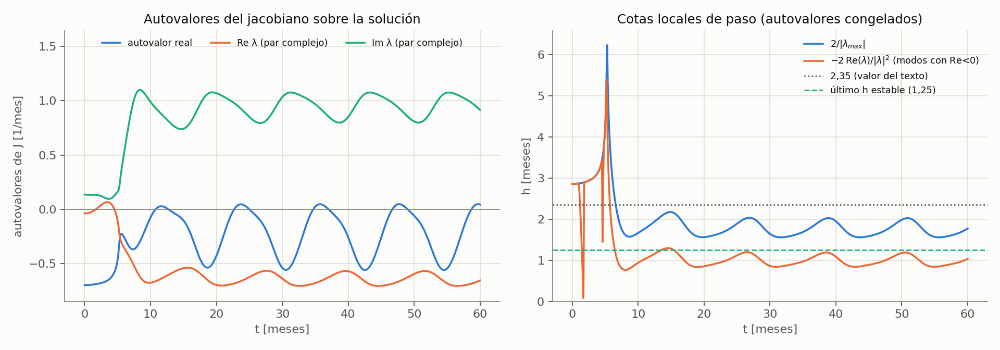
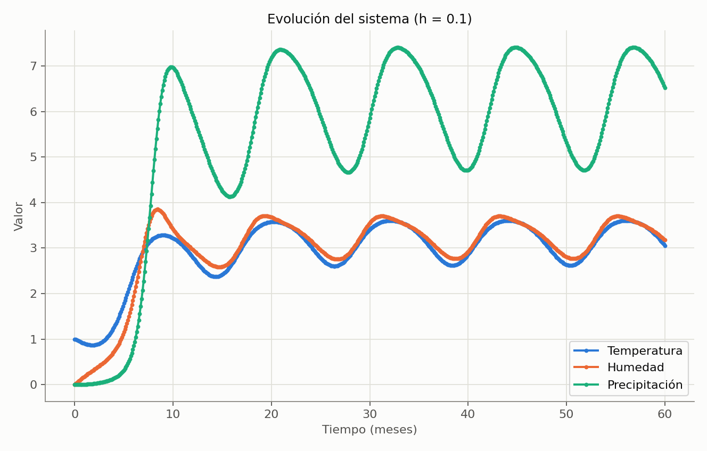

# TRABAJO PRÁCTICO "EL SUPER NIÑO"

**UNIVERSIDAD DE BUENOS AIRES**
**FACULTAD DE INGENIERÍA – DPTO. DE COMPUTACIÓN**

| | |
|---|---|
| **T.P. N°** | 1 |
| **Asignatura** | Modelación numérica (CB-051) / Análisis Numérico I (9504) |
| **Cuatrimestre** | 2do. Cuatrimestre 2026 |
| **Grupo de trabajo práctico** | N° 1 |
| **Fecha de realización** | 1/11/2026 |
| **Fecha de entrega** | 13/11/2026 |

**Integrantes del trabajo práctico**

| Nombre y apellido | Padrón |
|---|---|
| Ezequiel Ariel Miño | 107646 |
| Agustín Lucchelli | 109337 |
| Lorenzo Busato | 110490 |

---

## Índice

1. [Introducción al trabajo práctico](#1-introducción-al-trabajo-práctico)
2. [Parte 1: Convergencia, orden y estabilidad del método de Euler explícito](#2-parte-1-convergencia-orden-y-estabilidad-del-método-de-euler-explícito)
   - 2.1. Solución de referencia
   - 2.2. Resolución con sucesivos pasos h
   - 2.3. Verificación experimental
   - 2.4. Resolución con el paso temporal aumentado
3. [Parte 2: Severidad estacional, desfase y sensibilidad paramétrica](#3-parte-2-severidad-estacional-desfase-y-sensibilidad-paramétrica)
   - 3.1. Determinación de parámetros nominales
   - 3.2. Análisis e influencia de los factores
   - 3.3. Combinaciones posibles de los factores
   - 3.4. Comparación de casos
4. [Código de Python](#4-código-de-python)
5. [Bibliografía y fuentes](#5-bibliografía-y-fuentes)
6. [Uso de IA](#6-uso-de-ia)

---

## 1. Introducción al trabajo práctico

El fenómeno El Niño – Oscilación del Sur es un ejemplo de sistema dinámico acoplado: una perturbación térmica del océano puede producir, con cierto retardo, respuestas en la humedad atmosférica y en la precipitación. En este trabajo se utiliza un modelo temporal simplificado de tres variables para estudiar, por un lado, propiedades numéricas del método de Euler explícito aplicado a un problema de valores iniciales (convergencia, orden y estabilidad) y, por otro, la respuesta del modelo frente a cambios en sus parámetros.

Las variables del modelo son $T(t)$, la anomalía de temperatura superficial del mar [°C]; $H(t)$, la anomalía de humedad en la atmósfera baja [u.h.]; y $P(t)$, una variable simplificada asociada a la precipitación o nubosidad [u.p.]. Se resuelve el sistema de ecuaciones diferenciales ordinarias no lineales

$$\frac{dT}{dt} = R(t)\,T\left(1-\frac{T}{T_{max}}\right) - \alpha H$$

$$\frac{dH}{dt} = \beta T^2 - \gamma H P$$

$$\frac{dP}{dt} = \delta H^2 - \sigma P$$

con una excitación estacional de período anual en la tasa de crecimiento térmico:

$$R(t) = R_{oce} + A\cos(\omega t - \pi), \qquad \omega = \frac{2\pi}{12}$$

Cada término tiene un papel físico: $R(t)T(1-T/T_{max})$ es un crecimiento logístico de la temperatura modulado por las estaciones; $-\alpha H$ es el enfriamiento por evaporación; $\beta T^2$ es la fuente de humedad (un mar más caliente evapora más); $-\gamma HP$ es el consumo de humedad por la lluvia; $\delta H^2$ es la conversión de humedad en lluvia y $-\sigma P$ es la descarga o disipación de la precipitación sobre el continente.

**Parámetros nominales**

| Parámetro | Significado físico | Valor nominal |
|---|---|---|
| $T_{max}$ | Anomalía máxima térmicamente sostenible | 4,0 °C |
| $R_{oce}$ | Tasa intrínseca de calentamiento oceánico | 0,30 mes⁻¹ |
| $\alpha$ | Coeficiente de enfriamiento por evaporación | 0,05 |
| $\beta$ | Eficiencia de evaporación | 0,20 |
| $\gamma$ | Tasa de consumo de humedad por precipitación | 0,10 |
| $\delta$ | Eficiencia de conversión de humedad a lluvia | 0,40 |
| $\sigma$ | Tasa de descarga/disipación sobre el continente | 0,70 mes⁻¹ |
| $A$ | Amplitud de la modulación estacional | 0,45 mes⁻¹ |
| $\omega$ | Frecuencia angular de un ciclo anual | $2\pi/12$ rad/mes |

Condiciones iniciales: $T(0)=1{,}0$ °C, $H(0)=0$ u.h., $P(0)=0$ u.p. Intervalo de integración: $0 \le t \le 60$ meses.

El trabajo se divide en dos partes. En la Parte 1 se analiza el comportamiento numérico del método de Euler explícito. En la Parte 2 se usa una discretización suficientemente precisa y estable para estudiar la severidad estacional de las precipitaciones, el desfase entre temperatura y precipitación y la sensibilidad a los parámetros $A$, $\beta$, $\gamma$ y $\sigma$. El código en Python se entrega en un notebook y se describe en la sección 4.

---

## 2. Parte 1: Convergencia, Orden y estabilidad del método de Euler explícito

### 2.1. Solución de referencia

Para resolver este inciso, comenzamos analizando la estabilidad del método de Euler explícito aplicado al sistema de ecuaciones diferenciales planteado en el trabajo práctico. Con el objetivo de fundamentar la elección de un paso temporal adecuado, trabajamos conjuntamente con una herramienta de inteligencia artificial para desarrollar el análisis teórico de estabilidad y contrastarlo con los resultados obtenidos experimentalmente mediante nuestras simulaciones.

En primer lugar, expresamos el sistema de ecuaciones diferenciales en forma matricial, definiendo el vector de variables dependientes:

<span style="color:red">**Agregar vector de variables independientes.**</span>

$$\mathbf{y}(t) = \begin{pmatrix} T(t) \\ H(t) \\ P(t) \end{pmatrix}, \qquad \mathbf{y}(0) = \begin{pmatrix} 1{,}0 \\ 0 \\ 0 \end{pmatrix}$$

$$\frac{d\mathbf{y}}{dt} = \mathbf{f}(t,\mathbf{y}) = \begin{pmatrix} R(t)\,T\left(1-\dfrac{T}{T_{max}}\right) - \alpha H \\[2mm] \beta T^2 - \gamma H P \\[1mm] \delta H^2 - \sigma P \end{pmatrix}$$

A partir de las ecuaciones originales, construimos la matriz Jacobiana del sistema, que se obtiene derivando cada una de las funciones respecto de las tres variables dependientes:

<span style="color:red">**Agregar matriz jacobiana.**</span>

$$J(t,T,H,P) = \frac{\partial \mathbf{f}}{\partial \mathbf{y}} = \begin{pmatrix} \dfrac{\partial f_1}{\partial T} & \dfrac{\partial f_1}{\partial H} & \dfrac{\partial f_1}{\partial P} \\[2mm] \dfrac{\partial f_2}{\partial T} & \dfrac{\partial f_2}{\partial H} & \dfrac{\partial f_2}{\partial P} \\[2mm] \dfrac{\partial f_3}{\partial T} & \dfrac{\partial f_3}{\partial H} & \dfrac{\partial f_3}{\partial P} \end{pmatrix} = \begin{pmatrix} R(t)\left(1-\dfrac{2T}{T_{max}}\right) & -\alpha & 0 \\[2mm] 2\beta T & -\gamma P & -\gamma H \\[2mm] 0 & 2\delta H & -\sigma \end{pmatrix}$$

Esta matriz permite estudiar el comportamiento local del sistema frente a pequeñas perturbaciones. Para ello, calculamos sus autovalores mediante la ecuación característica:

$$\det(J - \lambda I) = 0$$

Los autovalores obtenidos permiten analizar la estabilidad local del sistema. En particular, para el método de Euler explícito, el factor de amplificación asociado a cada autovalor es:

$$G_i = 1 + h\lambda_i$$

Para que el método sea estable, se requiere que el módulo de estos factores no supere la unidad:

$$|1 + h\lambda_i| \le 1$$

En el caso de autovalores reales negativos, esta condición conduce a la siguiente restricción para el paso temporal:

$$h \le \frac{2}{|\lambda_{max}|}$$

De esta manera, el análisis de los autovalores permite establecer un criterio teórico para seleccionar el tamaño del paso de integración.

<mark><span style="color:red">Dándonos un valor (teórico de paso crítico de 2,35)</span></mark>

<mark><span style="color:red">Agregar graficos</span></mark>



*Figura 1: Izquierda: autovalores del jacobiano evaluado sobre la solución (un autovalor real y un par complejo conjugado). Derecha: cota local de paso con los autovalores congelados en cada instante, tanto $2/|\lambda_{max}|$ como $-2\,\mathrm{Re}(\lambda)/|\lambda|^2$ (modos con $\mathrm{Re}(\lambda)<0$); se marcan 2,35 y el último paso estable observado (1,25). En el último ciclo, $2/|\lambda_{max}|$ varía entre 1,56 y 2,03 meses.*


*Figura 2: Izquierda: límite local $h_{crit}(t)$ en el último ciclo. Derecha: radio espectral del mapa de Euler linealizado sobre un ciclo anual (multiplicadores de Floquet) en función de $h$; cruza 1 entre $h = 0{,}92$ y $h = 1{,}00$.*

Posteriormente, realizamos un análisis experimental mediante distintas simulaciones, incrementando progresivamente el tamaño del paso temporal y observando el comportamiento de las soluciones obtenidas. A partir de este procedimiento, nuestro grupo determinó que el paso crítico es aproximadamente:

**H**critico de referencia= 1,26 meses


*Figura 3: Izquierda: soluciones de Euler con pasos estables ($h = 0{,}8;\ 1{,}0;\ 1{,}25$) frente a la solución de referencia. Centro: soluciones inestables ($h = 1{,}26$ y $h = 1{,}6$), con el eje recortado. Derecha: error máximo en $T$ en el borde de estabilidad.*

Este valor se tomó como referencia experimental para establecer un límite superior y seleccionar un paso temporal que se encuentre suficientemente alejado de la región donde comienzan a observarse problemas de estabilidad numérica.

En función de este análisis, decidimos adoptar como paso temporal de referencia:

**H**referencia= 0,1 meses

<span style="color:red">**Agregar gráficos**</span>



*Figura 4: Solución de Euler explícito con $h = 0{,}1$ meses: $T(t)$, $H(t)$ y $P(t)$ para $0 \le t \le 60$ meses.*

La elección representa aproximadamente un 7,94 % del paso crítico experimental, por lo que consideramos que constituye una discretización suficientemente fina para utilizar como referencia en las comparaciones posteriores.

Finalmente, teniendo en cuenta que el intervalo de integración comprende 60 meses, la cantidad de iteraciones necesarias resulta:

$$N = \frac{60}{0{,}1} = 600$$

Por lo tanto, resolvemos el sistema mediante el método de Euler explícito, utilizando $h_{ref} = 0{,}1$ meses y las condiciones iniciales establecidas en el enunciado. La solución obtenida será utilizada como referencia para evaluar los errores de las distintas discretizaciones que se estudiarán en el inciso 1.b.


### 2.2. Resolución con sucesivos pasos de H

Para analizar la influencia del tamaño del paso temporal en la precisión del método de Euler explícito, se resolvió nuevamente el sistema de ecuaciones diferenciales utilizando tres pasos temporales diferentes: ($h=0{,}2$), ($h=0{,}4$) y ($h=0{,}8$).

Como solución de referencia se tomó la obtenida en el inciso anterior, utilizando un paso temporal ($h_{ref}=0{,}1$).

Para comparar las distintas aproximaciones, se calculó el error absoluto de la variable temperatura ($T(t)$) en cada instante de tiempo coincidente entre las discretizaciones. Posteriormente, se determinó el máximo error absoluto registrado a lo largo de todo el intervalo de integración, de acuerdo con la siguiente expresión:

$$Err(h) = \max_{0 \le t \le 60} \left| T_h(t) - T_{ref}(t) \right|$$

Los resultados obtenidos se presentan en la siguiente tabla:

| Paso temporal (h) | Error máximo absoluto (°C) |
|---|---|
| 0,1 | 0 |
| 0,2 | 0,047374 |
| 0,4 | 0,144940 |
| 0,8 | 0,351445 |

A partir de los resultados se observa que, al aumentar el paso temporal, también aumenta el error máximo respecto de la solución de referencia. Esto se debe a que el método de Euler explícito aproxima la evolución del sistema mediante incrementos sucesivos, y al utilizar pasos temporales más grandes se obtiene una representación menos precisa de la solución.

En particular, para ($h=0{,}2$) se obtuvo el menor error entre las discretizaciones analizadas, mientras que para ($h=0{,}8$) se registró la mayor diferencia respecto de la referencia.

Para complementar el análisis, se identificó el instante en el que se produce el máximo error para cada discretización. Se obtuvo aproximadamente ($t=5{,}4$) meses para ($h=0{,}2$), y ($t=5{,}6$) meses para ($h=0{,}4$) y ($h=0{,}8$).

En conclusión, los resultados muestran que la elección del paso temporal tiene una influencia directa sobre la precisión de la solución numérica. Cuanto menor es el paso utilizado, mejor es la aproximación obtenida respecto de la solución de referencia, dentro del conjunto de discretizaciones estudiadas.


### 2.3. Verificación experimental

**Análisis del orden de convergencia**

Para analizar el orden de convergencia del método de Euler explícito, se utilizó la expresión propuesta en la consigna:

$$p = \frac{\log\left(Err(2h)/Err(h)\right)}{\log 2}$$

A partir de los errores máximos absolutos calculados en el inciso anterior, se obtuvieron los siguientes resultados:

- Para la comparación entre ($h=0{,}2$) y ($h=0{,}4$), se obtuvo un orden observado de ($p_2=1{,}613288$).
- Para la comparación entre ($h=0{,}4$) y ($h=0{,}8$), se obtuvo un orden observado de ($p_3=1{,}277843$).

No fue posible determinar ($p_1$), correspondiente a la comparación entre ($h=0{,}1$) y ($h=0{,}2$), debido a que el error de la solución de referencia respecto de sí misma es nulo. Por lo tanto, la expresión utilizada no está definida para esa comparación.

De acuerdo con la teoría numérica, el método de Euler explícito es un método de primer orden, por lo que se espera que el error global sea proporcional al paso temporal ($h$). En consecuencia, el orden de convergencia esperado es ($p=1$).

Los valores obtenidos para ($p_2$) y ($p_3$) son superiores a 1, aunque muestran una tendencia de aproximación hacia dicho valor al aumentar el paso de comparación. Esto indica que las discretizaciones analizadas no permiten verificar exactamente el comportamiento asintótico de primer orden.

Una posible explicación es que los pasos temporales utilizados todavía no se encuentran completamente dentro del régimen asintótico de convergencia y que la solución de referencia, al estar calculada mediante Euler con ($h=0{,}1$), también presenta un error numérico respecto de la solución exacta.

En conclusión, los resultados permiten observar que el error aumenta al incrementar el paso temporal y son compatibles con el comportamiento convergente del método. Sin embargo, para verificar experimentalmente con mayor precisión el orden teórico de Euler, sería conveniente utilizar una solución de referencia con un paso temporal menor.


### 2.4. Resolución con el paso temporal aumentado

**1.d. Análisis de estabilidad numérica**

Para continuar con el análisis del método de Euler explícito, se incrementó progresivamente el paso temporal, duplicándolo en cada simulación. Se utilizaron los valores ($h=0{,}1$), (0,2), (0,4), (0,8), (1,6), (3,2) y (6,4) meses.

En primer lugar, se observó que para los pasos comprendidos entre (0,1) y (0,8) meses las simulaciones completaron el intervalo de integración de 60 meses. En este rango, el error máximo absoluto de la temperatura aumentó progresivamente, desde 0,047374 °C para ($h=0{,}2$) hasta 0,351445 °C para ($h=0{,}8$). Este comportamiento corresponde principalmente al error de discretización, que aparece debido a la aproximación numérica realizada por el método.

Sin embargo, al utilizar un paso temporal de ($h=1{,}6$) meses, se observó un crecimiento abrupto de las variables del sistema, que dejaron de presentar un comportamiento acotado. La simulación no pudo completar los 60 meses, evidenciando una pérdida de estabilidad numérica. Este comportamiento también se presentó para los pasos temporales de ($h=3{,}2$) y ($h=6{,}4$).

A partir de estos resultados, se identifica que el comienzo de la inestabilidad se encuentra entre los pasos ($h=0{,}8$) y ($h=1{,}6$) meses.

Es importante diferenciar el error de discretización de la inestabilidad numérica. El primero representa la diferencia entre la solución aproximada y la solución de referencia, y aumenta gradualmente al incrementar el paso temporal. En cambio, la inestabilidad numérica se manifiesta mediante un crecimiento abrupto y descontrolado de los valores calculados, haciendo que la solución obtenida deje de representar adecuadamente el comportamiento del sistema.

En conclusión, los resultados muestran que el método de Euler explícito presenta un comportamiento estable para los pasos temporales de hasta ($h=0{,}8$) meses dentro de las simulaciones realizadas. Al aumentar el paso a ($h=1{,}6$) meses, se evidencia inestabilidad numérica. Por este motivo, resulta necesario seleccionar un paso temporal suficientemente pequeño para obtener resultados confiables, evitando que los errores numéricos comprometan la solución.

---

## 3. Parte 2: Severidad estacional, desfase y sensibilidad paramétrica

### 3.1. Determinación de parámetros nominales

Debido al régimen transitorio asociado a las condiciones iniciales, los indicadores se calculan únicamente con el último ciclo anual, $48 \le t \le 60$ meses. La severidad estacional de las precipitaciones y el desfase temperatura–precipitación se definen como

$$S_P = \frac{P_{max} - P_{min}}{P_{med}}, \qquad \Delta t_{TP} = t_{P,max} - t_{T,max}$$

donde $P_{max}$, $P_{min}$ y $P_{med}$ se calculan en el último ciclo ($P_{med}$ es el promedio temporal, por integral trapezoidal dividida por la duración), $t_{T,max}$ es el instante del máximo de $T$ y $t_{P,max}$ el del máximo de $P$. Los máximos se localizan sobre la grilla y se refinan con una parábola por tres puntos.

**Elección del paso.** Según la Parte 1, Euler resulta estable para pasos de hasta $h = 0{,}8$ y pierde la estabilidad entre $h = 0{,}8$ y $h = 1{,}6$ (experimentalmente, alrededor de $h \approx 1{,}26$), y su error aumenta con $h$. Para esta parte se verificó cómo cambian los indicadores al achicar el paso, comparando contra una solución de Runge-Kutta de orden 4 con $h = 0{,}0005$ (solo como control independiente):

**Tabla 7.** Indicadores nominales según el paso utilizado.

| h [meses] | Err máx. en T [°C] | S_P | Δt_TP [meses] |
|---|---|---|---|
| 0,5000 | 2,41e-01 | 0,50037 | 0,2187 |
| 0,2500 | 1,17e-01 | 0,45488 | 0,5481 |
| 0,1000 | 4,62e-02 | 0,43810 | 0,7350 |
| 0,0500 | 2,29e-02 | 0,43311 | 0,7846 |
| 0,0250 | 1,14e-02 | 0,43073 | 0,8071 |
| 0,0100 | 4,57e-03 | 0,42932 | 0,8200 |
| 0,0050 | 2,28e-03 | 0,42885 | 0,8241 |
| 0,0025 | 1,14e-03 | 0,42862 | 0,8262 |
| 0,0010 | 4,56e-04 | 0,42848 | 0,8274 |
| RK4 (referencia) | — | 0,42839 | 0,8283 |

Con $h =$ 0,001 el error máximo en $T$ es de 4,6e-04 °C y los indicadores coinciden con la referencia en 9,3e-05 para $S_P$ y en 0,0008 meses para $\Delta t_{TP}$. Se adopta entonces $h =$ 0,001 meses.

**Resultados con parámetros nominales** (Euler explícito, $h =$ 0,001):

| Magnitud | Valor |
|---|---|
| $P_{max}$ | 7,3752 |
| $P_{min}$ | 4,7360 |
| $P_{med}$ | 6,1596 |
| $S_P$ | **0,4285** |
| $t_{T,max}$ | 56,07 meses |
| $t_{P,max}$ | 56,90 meses |
| $\Delta t_{TP}$ | **0,83 meses** |


*Figura 5: T(t), H(t) y P(t) para los 60 meses con parámetros nominales (sombreado: último ciclo).*


*Figura 6: Último ciclo anual usado para calcular S_P y Δt_TP, con los instantes de máximo de T y de P.*

Luego de un transitorio de unos 2 a 3 años, las tres variables se repiten cada 12 meses. Se verificó que el último ciclo coincide con el anterior (diferencia relativa máxima de 4,1e-04), por lo que usar el último ciclo es válido. El máximo de precipitación llega 0,83 meses después del máximo de temperatura.


### 3.2. Análisis e influencia de los factores

Se modificó un parámetro por vez, manteniendo los restantes en su valor nominal, en los intervalos de la consigna (15 valores equiespaciados por parámetro).

**Tabla 8.** Efecto de cada parámetro en los extremos de su intervalo.

| Parámetro | Valor | S_P | Δt_TP [meses] | P_med | P_max − P_min |
|---|---|---|---|---|---|
| A | 0,250 (mín.) | 0,2154 | 0,958 | 6,414 | 1,382 |
| A | 0,600 (máx.) | 0,6267 | 0,740 | 5,881 | 3,686 |
| β | 0,100 (mín.) | 0,3392 | 1,313 | 4,151 | 1,408 |
| β | 0,300 (máx.) | 0,4854 | 0,687 | 7,683 | 3,729 |
| γ | 0,050 (mín.) | 0,5487 | 1,178 | 8,903 | 4,885 |
| γ | 0,200 (máx.) | 0,3340 | 0,670 | 4,158 | 1,389 |
| σ | 0,400 (mín.) | 0,3408 | 1,197 | 7,870 | 2,682 |
| σ | 1,000 (máx.) | 0,4806 | 0,774 | 5,229 | 2,513 |


*Figura 7: S_P(q) (arriba) y Δt_TP(q) (abajo) para cada parámetro; la línea punteada marca el valor nominal.*

**Tendencias observadas (datos calculados).** $S_P$ crece con $A$, $\beta$ y $\sigma$, y decrece con $\gamma$. $\Delta t_{TP}$ disminuye al aumentar cualquiera de los cuatro parámetros: la precipitación responde antes a la temperatura. Como $S_P$ es un cociente, conviene mirar también la amplitud $P_{max} - P_{min}$ y el promedio $P_{med}$ (Tabla 8): con $A$ y $\beta$ crece la amplitud; con $\gamma$ cae la amplitud; con $\sigma$ la amplitud casi no cambia (2,68 → 2,51) y lo que hace subir $S_P$ es que $P_{med}$ baja de 7,87 a 5,23.

**Interpretación a partir de los términos de las ecuaciones.** Estas lecturas son consistentes con los datos, pero los datos muestran la tendencia, no demuestran el mecanismo:

- **$A$** está en $R(t)$: una modulación estacional más fuerte hace oscilar más a $T$ y esa oscilación se transmite a $H$ y $P$. Por eso $S_P$ crece de forma casi lineal con $A$.
- **$\beta$** multiplica la fuente de humedad $\beta T^2$ (signo $+$): más humedad produce más lluvia vía $\delta H^2$. Crecen $P_{med}$ y la amplitud.
- **$\gamma$** multiplica el sumidero $-\gamma HP$ (signo $-$): cuanto mayor es, más humedad consume la lluvia, y $H$ y $P$ quedan más chicos y con menos contraste. Por eso $S_P$ disminuye con $\gamma$.
- **$\sigma$** multiplica el sumidero $-\sigma P$ (signo $-$): con $\sigma$ grande, $P$ decae rápido y sigue más de cerca a $H$ (menos inercia), lo que adelanta su máximo ($\Delta t_{TP}$ disminuye) y reduce su promedio.


### 3.3. Combinaciones posibles de los factores

Se exploró una grilla discreta de 2.401 combinaciones ($7 \times 7 \times 7 \times 7$ valores equiespaciados de $A$, $\beta$, $\gamma$ y $\sigma$ dentro de sus intervalos), simulando cada una con $h =$ 0,001 meses. Una combinación se considera válida si la solución es acotada y si al final de la simulación el régimen anual se repite (diferencia relativa máxima entre los dos últimos ciclos menor al 1 %). Las 2.401 combinaciones cumplieron ambos requisitos.

**Tabla 9.** Las cinco combinaciones de mayor severidad.

| S_P | A | β | γ | σ | Δt_TP [meses] |
|---|---|---|---|---|---|
| 0,9908 | 0,600 | 0,300 | 0,050 | 1,000 | 0,894 |
| 0,9619 | 0,600 | 0,300 | 0,050 | 0,900 | 0,879 |
| 0,9509 | 0,600 | 0,267 | 0,050 | 1,000 | 0,970 |
| 0,9288 | 0,600 | 0,300 | 0,050 | 0,800 | 0,874 |
| 0,9248 | 0,600 | 0,267 | 0,050 | 0,900 | 0,957 |

La combinación de mayor severidad es **$A =$ 0,60, $\beta =$ 0,30, $\gamma =$ 0,05, $\sigma =$ 1,00**, con $S_P =$ 0,9908. Las demás combinaciones del podio repiten $A = 0{,}60$ y $\gamma = 0{,}05$, en línea con las tendencias de 3.2. El óptimo queda en un vértice del dominio de búsqueda; esto es coherente con que $S_P$ sea monótono en cada parámetro en los barridos individuales, aunque la grilla no demuestra que no exista un máximo mayor entre nodos.


*Figura 8: S_P en el plano (γ, A) con β y σ en su valor óptimo.*


### 3.4. Comparación de casos

**Tabla 10.** Caso nominal frente al escenario de mayor severidad (último ciclo anual).

|  | Nominal | Mayor severidad |
|---|---|---|
| $A$ | 0,45 | 0,60 |
| $\beta$ | 0,20 | 0,30 |
| $\gamma$ | 0,10 | 0,05 |
| $\sigma$ | 0,70 | 1,00 |
| **$S_P$** | **0,4285** | **0,9908** |
| **$\Delta t_{TP}$ [meses]** | **0,827** | **0,894** |
| $P_{max}$ | 7,375 | 12,649 |
| $P_{min}$ | 4,736 | 4,330 |
| $P_{med}$ | 6,160 | 8,396 |


*Figura 9: Caso nominal y escenario de mayor severidad: 60 meses (arriba) y último ciclo (abajo).*


*Figura 10: Último ciclo del escenario de mayor severidad.*

La severidad se multiplica por 2,3 (de 0,428 a 0,991): $P_{max}$ pasa de 7,38 a 12,65 y $P_{min}$ casi no cambia (4,74 → 4,33). El desfase pasa de 0,83 a 0,89 meses, es decir que casi no se modifica.

**¿El escenario de mayor severidad corresponde a tomar todos los parámetros en su valor máximo? No.** $A$, $\beta$ y $\sigma$ están en su máximo, pero $\gamma$ está en su **mínimo**. Si se toman los cuatro en su máximo ($A = 0{,}60$, $\beta = 0{,}30$, $\gamma = 0{,}20$, $\sigma = 1{,}00$) resulta $S_P =$ 0,6259, mucho menor que 0,9908. Partiendo del escenario severo y llevando de a un parámetro al extremo opuesto, $S_P$ siempre empeora:

**Tabla 11.** S_P al llevar un parámetro al extremo opuesto del escenario severo.

| Parámetro modificado | Nuevo valor | S_P | Variación |
|---|---|---|---|
| A | 0,25 | 0,3729 | -0,6179 |
| β | 0,10 | 0,6370 | -0,3538 |
| γ | 0,20 | 0,6259 | -0,3649 |
| σ | 0,40 | 0,7089 | -0,2819 |

**Justificación por el signo y la función de cada término:**

- $A$ (en $R(t)$): refuerza la modulación estacional de la temperatura y por lo tanto la oscilación anual de toda la cadena $T \to H \to P$. Máximo $A$ favorece la severidad.
- $\beta$ (término $+\beta T^2$ en $dH/dt$): es la fuente de humedad que alimenta a la lluvia a través de $+\delta H^2$. Máximo $\beta$ favorece la severidad.
- $\sigma$ (término $-\sigma P$ en $dP/dt$): es un sumidero de $P$, pero con $\sigma$ grande $P$ responde rápido a $H$ y su promedio baja, lo que aumenta el cociente $(P_{max} - P_{min})/P_{med}$ (en los barridos casi no cambia la amplitud). Máximo $\sigma$ favorece la severidad.
- $\gamma$ (término $-\gamma HP$ en $dH/dt$): es un sumidero de $H$ que actúa cuando hay lluvia y atenúa los picos. Su efecto sobre $S_P$ tiene signo opuesto al de los otros tres, por lo que la severidad máxima se logra con $\gamma$ en su **mínimo**.

Entonces, no basta con "subir todo": hay que distinguir entre parámetros que **alimentan o amplifican** la cadena ($A$, $\beta$), parámetros que **disminuyen el promedio** de lluvia ($\sigma$) y parámetros que **amortiguan** ($\gamma$), cuyo efecto sobre la severidad es el opuesto.

---

## 4. Código de Python

Todo el código que generó los números y las 10 figuras de este informe está en el notebook **`TP_El_Super_Nino.ipynb`**, que se entrega junto con el informe. Está explicado paso a paso con texto, sigue el mismo orden que el informe y guarda cada figura en `resultados/` con el nombre que se usa acá.

| Sección del notebook | Contenido | Figuras |
|---|---|---|
| 0 | Parámetros, modelo, Euler explícito, RK4 (control), jacobiano, indicadores del último ciclo | — |
| Parte 1 (1.1 a 1.6 y anexo) | Jacobiano y autovalores, Floquet, umbral de divergencia, referencia $h = 0{,}1$, errores, orden y paso aumentado | 1 a 4 |
| Parte 2 (2.1 a 2.4) | Caso nominal, barridos de $A$, $\beta$, $\gamma$, $\sigma$, grilla de 2.401 combinaciones y comparación | 5 a 10 |

Ejecución (la grilla de 3.3 tarda unos minutos; con `RAPIDO = True` en la primera celda usa $h = 0{,}01$ solo en la grilla):

```
pip install -r requirements.txt
jupyter notebook TP_El_Super_Nino.ipynb
```

Función central, Euler explícito (celda de funciones comunes del notebook):

```python
def euler(p, h, t_fin=T_FIN, y0=Y0, limite=1e6):
    """
    Euler explícito: y_{n+1} = y_n + h f(t_n, y_n).

    Devuelve (t, y) con y de forma (n+1, 3) = columnas T, H, P.
    Si h no divide a t_fin, el último paso es más corto para terminar
    exactamente en t_fin. Si la solución supera `limite` en módulo
    (divergencia; los valores físicos son de orden 1-10) se corta la
    integración y el resto de la trayectoria se completa con NaN.
    """
    n = int(math.ceil(t_fin / h - 1e-9))
    h_ult = t_fin - (n - 1) * h
    y = np.full((n + 1, 3), np.nan)
    T, H, P = y0
    y[0] = y0
    Tmax, Roce, al, be, ga, de, si, A = (p["Tmax"], p["Roce"], p["alpha"],
                                         p["beta"], p["gamma"], p["delta"],
                                         p["sigma"], p["A"])
    cos = math.cos
    for k in range(n):
        hk = h_ult if k == n - 1 else h
        R = Roce + A * cos(OMEGA * (k * h) - math.pi)
        dT = R * T * (1.0 - T / Tmax) - al * H
        dH = be * T * T - ga * H * P
        dP = de * H * H - si * P
        T, H, P = T + hk * dT, H + hk * dH, P + hk * dP
        if not (abs(T) < limite and abs(H) < limite and abs(P) < limite):
            break
        y[k + 1] = (T, H, P)
    t = np.arange(n + 1) * h
    t[-1] = t_fin
    return t, y
```

---

## 5. Bibliografía y fuentes

- Consigna del trabajo práctico, *CB051 Modelación Numérica / 9504 Análisis Numérico I*, 2do cuatrimestre 2026, FIUBA.
- Burden, R. L. y Faires, J. D., *Análisis numérico*, Cengage Learning.
- Chapra, S. C. y Canale, R. P., *Métodos numéricos para ingenieros*, McGraw-Hill.
- Documentación de NumPy y Matplotlib (https://numpy.org, https://matplotlib.org).
- Repositorio con el informe y el notebook de código: https://github.com/LoloBusato/TP_NUMERICO_2C_2026.
- Herramientas: Python 3, NumPy, Matplotlib, Jupyter. Se utilizó una herramienta de inteligencia artificial como apoyo para el desarrollo del código y la redacción; los resultados se generan con el notebook y fueron contrastados con una solución de referencia independiente (RK4).


---

## 6. Uso de IA

Se utilizó **Claude** (Anthropic), a través de la herramienta de línea de comandos y editor *Claude Code*, como asistente para el código, el análisis y la redacción. Lorenzo Busato fue quien le encargó las tareas; el modelo respondió leyendo los archivos del proyecto, ejecutando el código y editando los archivos. Esta sección describe qué se le pidió, qué respondió y cómo se controló el resultado.

### 6.1. Cómo se trabajó

- Los pedidos se hicieron en español, con instrucciones concretas sobre qué carpetas mirar, qué conservar y qué no tocar.
- La IA no inventó resultados: cada número y cada figura del informe sale del notebook `TP_El_Super_Nino.ipynb` y se puede reproducir ejecutándolo de arriba hacia abajo.
- Los resultados de Euler se contrastaron con una solución independiente de Runge-Kutta de orden 4 (Tabla 7), y la referencia de la solución se verificó repitiendo el cálculo con la mitad del paso.
- En el informe se distingue entre lo calculado y lo interpretado: las explicaciones del efecto de cada parámetro a partir de los términos de las ecuaciones están presentadas como interpretación, no como demostración.

### 6.2. Trabajo previo con IA (según el historial del repositorio)

A partir de los archivos y del historial de git, la IA realizó en sesiones anteriores el siguiente trabajo sobre los scripts del grupo (`solucion_sisteam_ecuaciones.py`, `tp_el_nino_parte2a.py` y `variacion_constantes.py`), cuyo contenido quedó reunido y explicado en el notebook `TP_El_Super_Nino.ipynb`:

| Hallazgo o cambio | Detalle |
|---|---|
| Error en $R(t)$ | Un script usaba $\sin(\omega t - \pi)$ y la consigna pide $\cos(\omega t - \pi)$; esto cambiaba, por ejemplo, $T(0{,}1)$ de 0,98875 a 1,0225. |
| Barridos de la Parte 2 | El diccionario de parámetros se modificaba sin restaurarse, por lo que no se variaba "un parámetro por vez"; además los barridos no llegaban a los extremos de los intervalos de la consigna. |
| Referencia de la Parte 1 | Euler con $h = 0{,}1$ tiene un error propio (0,046 °C) comparable al que se quiere medir; se propuso una referencia con $h_{ref} = 0{,}0001$. |
| Paso crítico "teórico" | $h \le 2/\lvert\lambda_{max}\rvert$ vale solo para autovalores reales negativos; con el par complejo del jacobiano el criterio correcto da $h \approx 1{,}0$. |
| Compatibilidad | `np.trapezoid` no existe en versiones de NumPy anteriores a 2.0. |

Los hallazgos sobre la referencia $h_{ref} = 0{,}1$ y sobre el paso crítico teórico no se incorporaron al texto de la Parte 1 (secciones 2.1 a 2.4), que se mantiene como lo redactó el grupo.

### 6.3. Pedidos de esta versión del informe y respuestas

**Pedido 1** (textual):

> Centrate en las carpetas TP y TP_NUMERICO_2C_2026. Quiero que en el INFORME.md las partes que ya estaban escritas por mis compañeros en TP\Modelacion_NUMERICA_\TP-Modelación numerica El superniño .pdf sigan estando igual y solo agreguemos las imagenes que pedian sin borrar sus textos rojos y solo hagamos las partes que no estaban hechas.

**Respuesta de la IA:**

- Identificó que existían dos PDF con el mismo nombre y usó el de la carpeta `Modelacion_NUMERICA_`, que es el que contiene las marcas rojas y amarillas.
- Conservó el texto de las secciones 2.1 a 2.4 sin cambios de contenido; solo corrigió el LaTeX roto que el PDF mostraba sin renderizar y agregó la fórmula de $p$, que estaba en blanco.
- Mantuvo todas las marcas rojas y amarillas y agregó debajo de cada una lo pedido: el vector de variables, la matriz jacobiana y los gráficos de autovalores, de estabilidad y de la solución con $h = 0{,}1$ (Figuras 1 a 4).
- Escribió las partes que estaban vacías (introducción, 3.1 a 3.4, código y bibliografía) a partir de los resultados del código.
- Informó que no logró reproducir el valor "2,35" del texto del grupo (con los autovalores calculados, $2/\lvert\lambda_{max}\rvert$ varía entre 1,56 y 6,24 según el instante) y por eso el pie de la Figura 1 solo muestra los valores calculados.
- Advirtió que la referencia $h = 0{,}1$ da órdenes de convergencia de 1,61 y 1,28, y que con una referencia más fina se obtiene aproximadamente 1,02, pero no modificó el texto del grupo.

**Pedido 2** (resumen): agregar al final del informe esta sección de uso de IA, con los pedidos y las respuestas.

### 6.4. Limitaciones

- La IA puede equivocarse: por eso los resultados se verificaron con un método independiente y las afirmaciones no demostradas se marcaron como interpretación.
- Los prompts de las sesiones anteriores no están transcriptos en este informe; la sección 6.2 se reconstruye a partir de los archivos y del historial de git, no de la conversación.
- La responsabilidad por el contenido del informe es de los integrantes del grupo.
